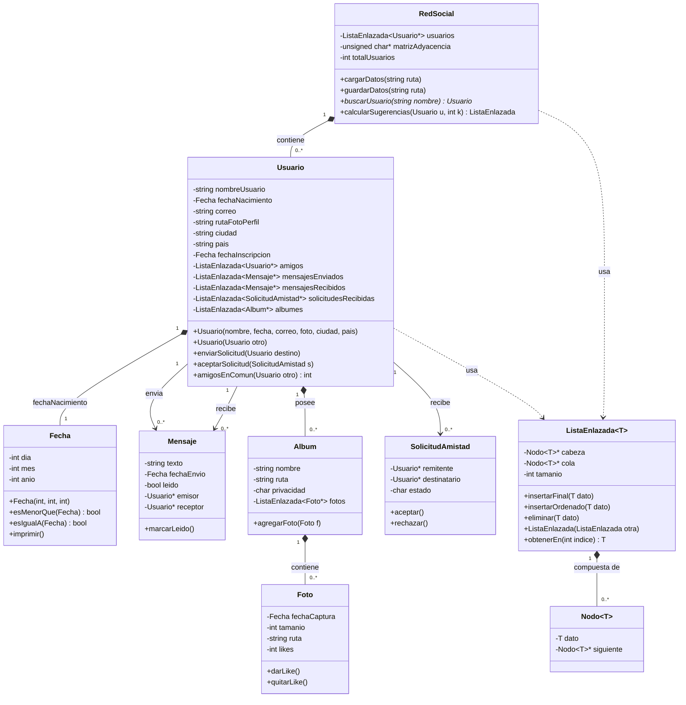
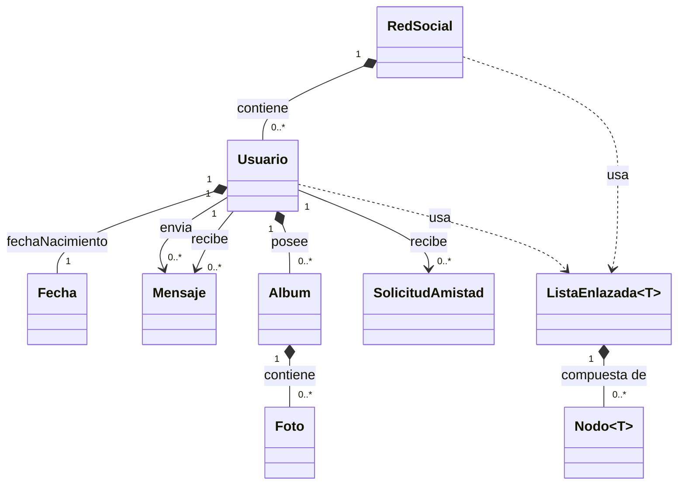

> **Nota: "amigos":** la relación de amistad entre usuarios (muchos a muchos, de `Usuario` consigo mismo) no se dibuja como línea aparte queda representada por el atributo `ListaEnlazada<Usuario*> amigos` dentro de la propia clase `Usuario`. 

# Diagrama de clases — versión resumen

