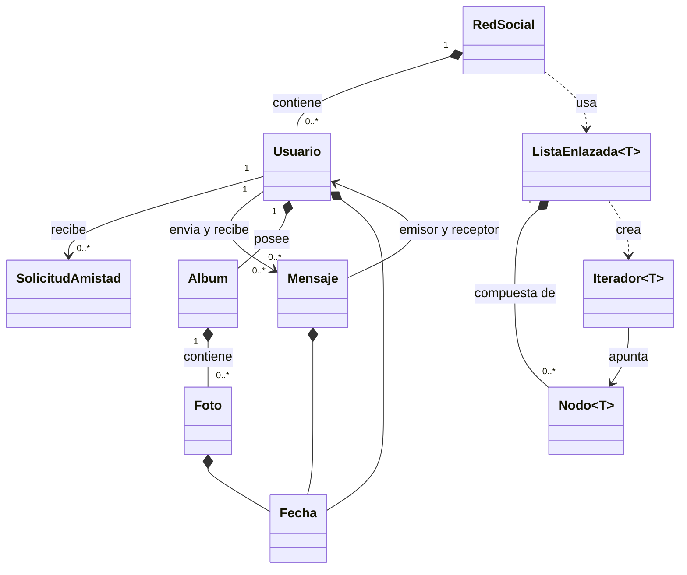
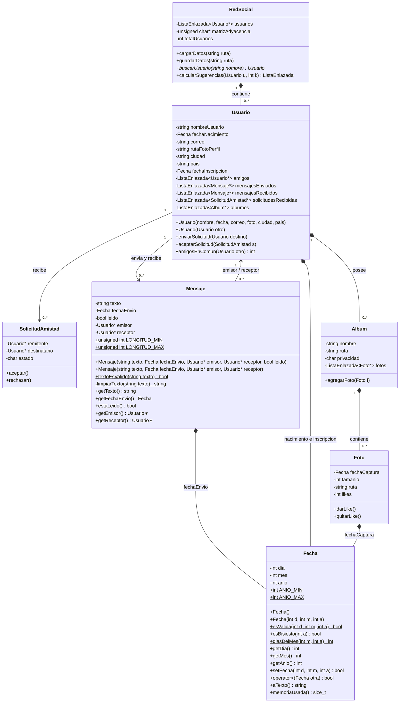
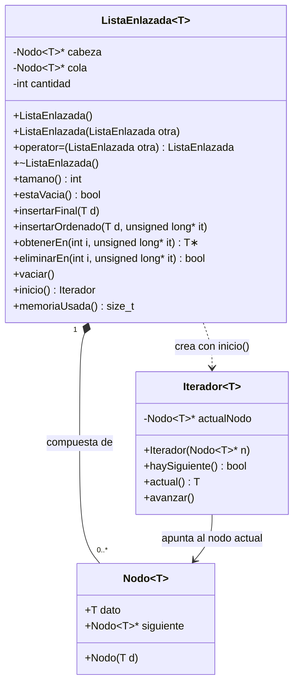

## tipo: diagrama version: 2 fecha: 2026-10-17

# Diagrama de clases — versión 2 (organizado en tres vistas)

Esta versión **continúa** la de la primera entrega (`05-Diseno-de-clases`), que no se modifica. Cambian las clases ya implementadas: `Fecha`, `Nodo<T>`, `ListaEnlazada<T>` y `Mensaje`. `Usuario`, `Album`, `Foto`, `SolicitudAmistad` y `RedSocial` siguen como en el diseño preliminar, aún sin implementar.

1. **Vista general:** todas las clases y cómo se relacionan.
2. **Dominio:** `RedSocial`, `Usuario`, `Mensaje`, `Album`, `Foto`, `SolicitudAmistad` y `Fecha`, con sus atributos y métodos.
3. **Estructuras de datos:** `ListaEnlazada<T>`, `Nodo<T>` e `Iterador<T>`.

`Usuario`, `Album` y `RedSocial` usan `ListaEnlazada<T>`: se ve en el tipo de sus atributos (por ejemplo `ListaEnlazada<Mensaje*> mensajesEnviados`).

## Vista general

## Dominio

## Estructuras de datos

